# UI до и после

Слева исходный frontend 7.7 из `4de88df`, справа новая версия. Реальный Chromium + одноразовая SQLite/PHP-среда; одинаковые синтетические данные. Масштаб одинаков внутри пары. Точные размеры и темы указаны в именах. Старое переполнение mobile-обсуждений сохранено как исходный дефект; новые страницы проходят проверку отсутствия горизонтального scroll.

## 1440-light-ru-projects

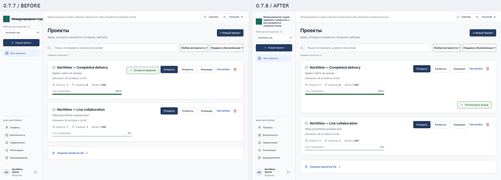

## 1440-light-ru-task

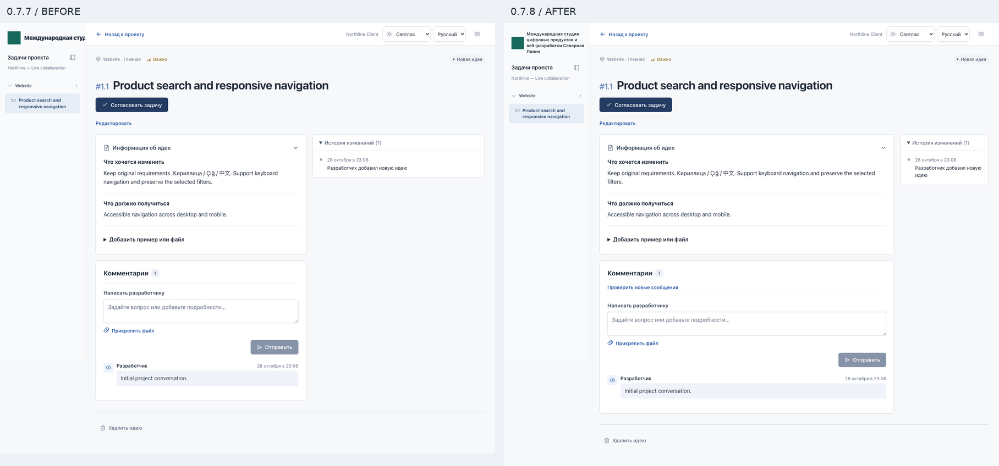

## 1440-light-ru-branding

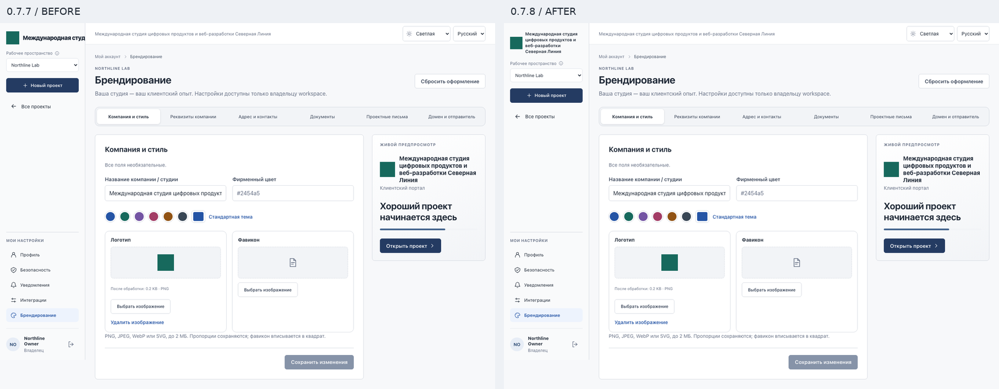

## 1440-light-ru-notifications

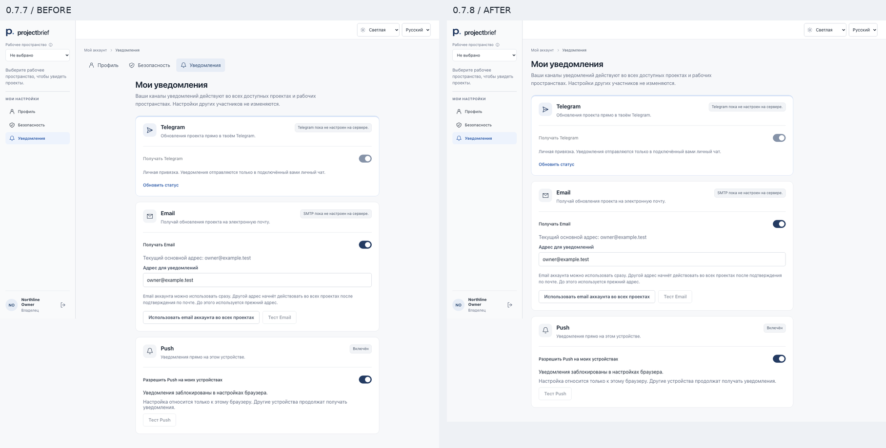

## 1440-light-ru-website

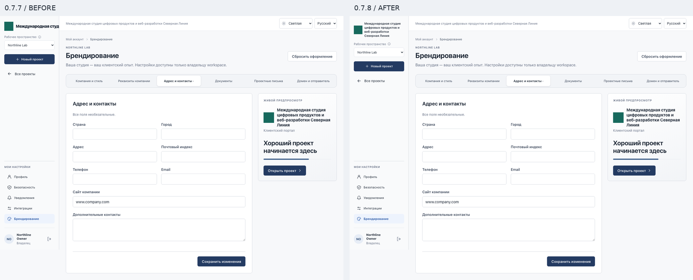

## 1440-light-ru-discussions

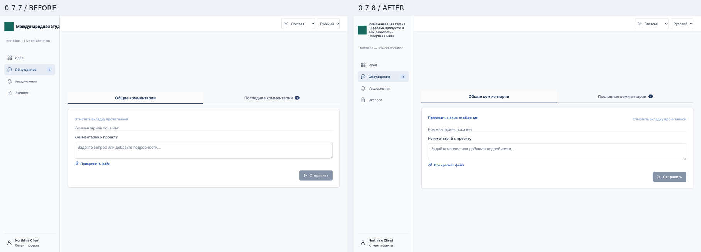

## 390-light-tr-projects

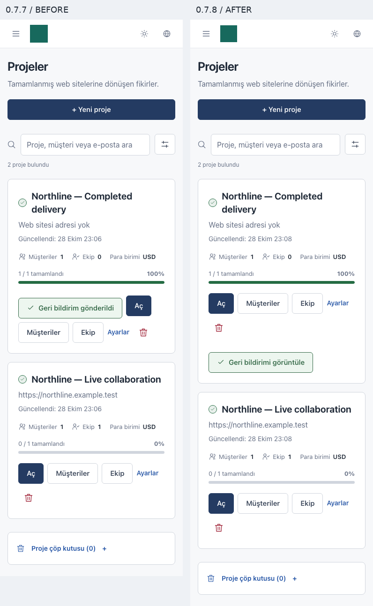

## 390-light-tr-task

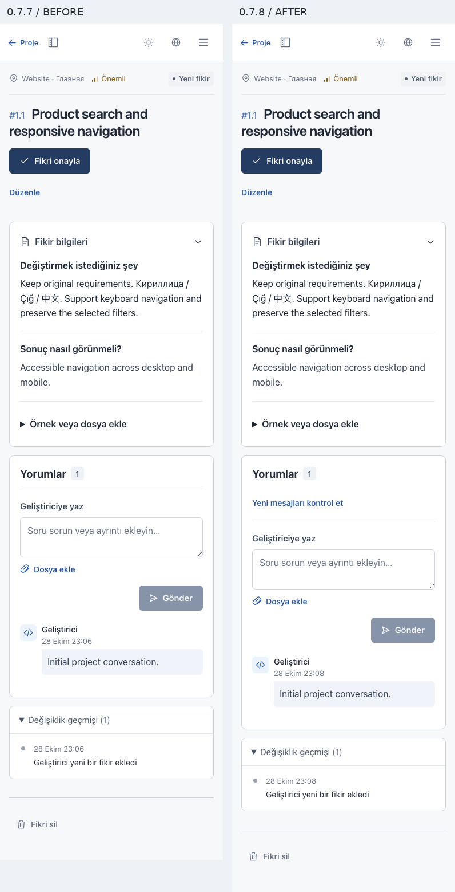

## 390-light-tr-branding

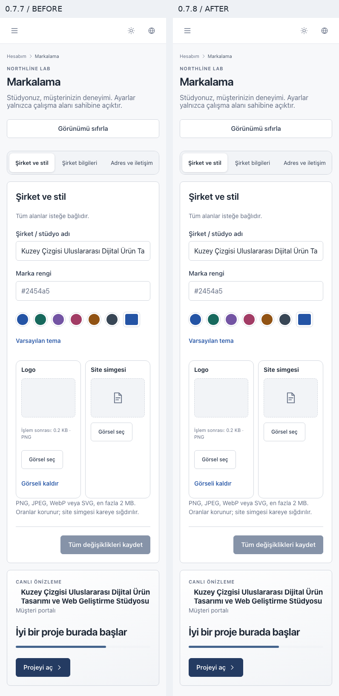

## 390-light-tr-notifications

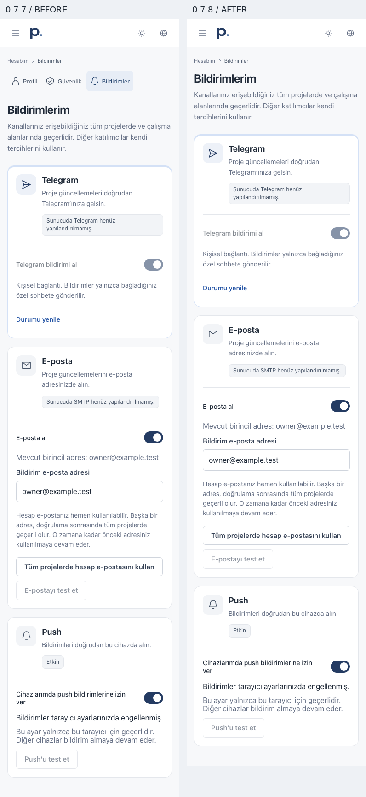

## 390-light-tr-website

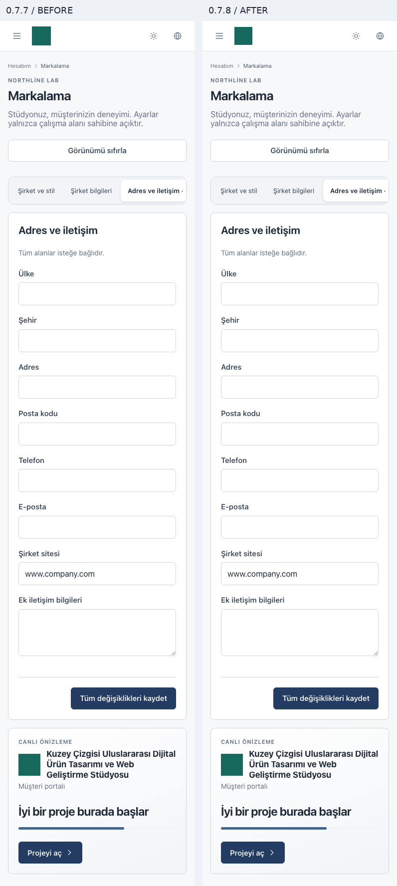

## 390-light-tr-discussions

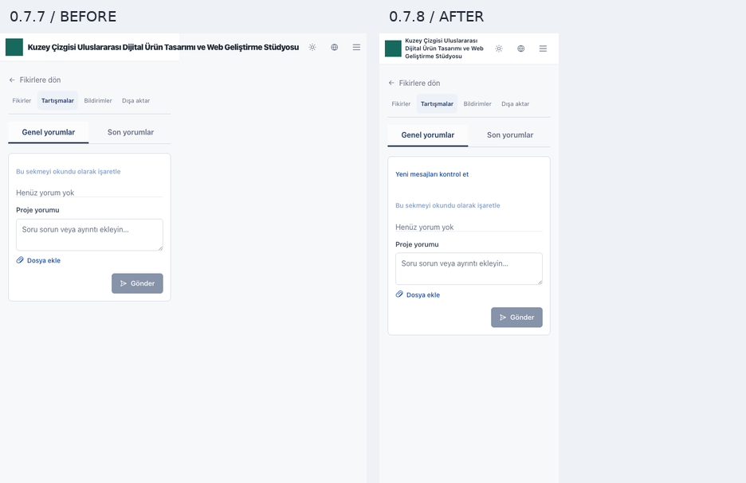
