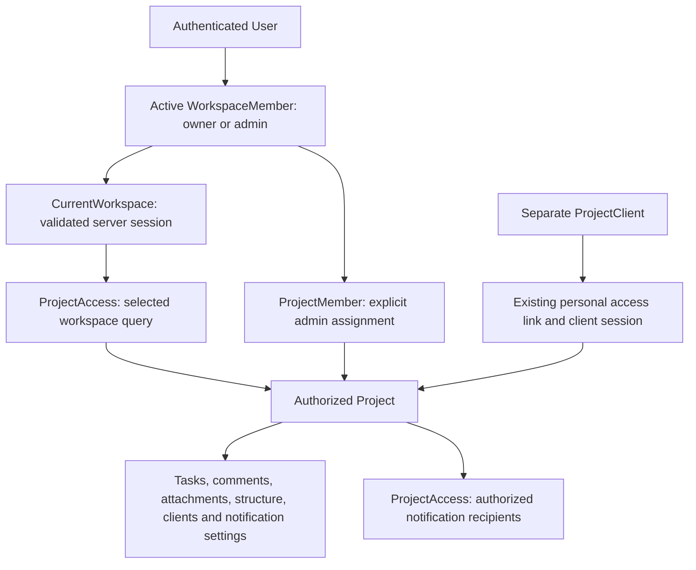

# Milestone 2 — SaaS foundation / tenant isolation

Implemented on `feature/saas-foundation`, 8 October 2026.
Starting commit: `4957e8e036e60b7082321783b6867ddb89609963`.
Only the tenant foundation is implemented. Existing navigation, client authentication,
PWA launch, explicit developer saves, localized mail and Push transport are retained.
No production deployment was performed.

## Architecture and authorization

`CurrentWorkspace` verifies active membership on every resolution. `ProjectAccess`
provides reusable project queries and authorized notification membership/user queries.
`TaskAccess` scopes tasks through the authorized project query. Attachments are scoped
through that same task query. There is no request-global Eloquent scope, hidden factory
grant or reliance on unguessable UUIDs.

`EnsureAdmin` now means authenticated owner/team interface access, not a global role.
It runs before Laravel model binding and replaces every admin route's `project`
parameter with a project selected through `ProjectAccess`. Thus clients, links,
sections, notification settings/tests and project task endpoints receive only an
authorized project before validation or controller work. Foreign and unassigned
project/task/file UUIDs return 404. Requests without a valid workspace context return
403; guests return 401.

| Membership                    | Workspace projects                  | Project access                                   |
| ----------------------------- | ----------------------------------- | ------------------------------------------------ |
| Active owner                  | All projects in that workspace      | Implicit; no ProjectMember row required          |
| Active admin                  | Assigned projects in that workspace | Requires a ProjectMember row for this membership |
| Inactive / missing membership | None                                | Denied regardless of legacy users.role           |

An admin-created project belongs to the current workspace and the creator gets an
assignment in the same transaction. The owner keeps implicit access. Project requests
reject supplied `workspace_id`/`workspaceId`; clients cannot supply tenant identity.
Numeric workspace IDs and membership/assignment records are not returned by APIs.

## Schema and migrations

The migrations are additive and forward-only, applied in this order:

1. `2026_10_08_122755_create_workspace_foundation.php`
2. `2026_10_08_122756_backfill_legacy_workspaces.php`
3. `2026_10_08_122757_enforce_project_workspace.php`

| Table / column          | Added or changed                                                               |
| ----------------------- | ------------------------------------------------------------------------------ |
| `workspaces`            | Numeric internal PK, unique public UUID, name, timestamps                      |
| `workspace_members`     | PK, workspace/user FKs, role, status, joined_at, timestamps                    |
| `projects.workspace_id` | Initially nullable for backfill; then mandatory restrictive workspace FK       |
| `project_members`       | PK, workspace_id, project_id, workspace_member_id, timestamps                  |
| `users.role`            | Existing column and values retained; future default changes from admin to user |

Memberships are unique per `(workspace_id, user_id)`. DB-enforced roles are `owner` and
`admin`; current statuses are `active` and `inactive`. Invitation states will require
an explicit later additive change; no invitation flow exists here.

Project assignments are unique per `(project_id, workspace_member_id)`. Composite
foreign keys `(project_id, workspace_id)` and `(workspace_member_id, workspace_id)`
reference matching parent pairs, so the DB rejects assignments across workspaces in
either direction. The duplicated assignment `workspace_id` serves this invariant,
not client input. Parent pair uniqueness is indexed. Workspace/user/membership/project
references use restrictive deletion; deleting a workspace cannot cascade away its
projects or team. No workspace deletion interface is provided.

The final schema rejects tenantless projects even when ordinary application code
calls `Project::create` without a workspace. Internal creation uses the workspace's
project relationship. No dependent legacy records, identifiers or paths are rewritten.

## Exact legacy backfill

Backfill uses raw DB rows in a transaction and is repeatable after success:

- A genuinely empty DB (no legacy admins or projects) stays empty: zero workspaces.
- Existing accounts that previously had admin access (`users.role=admin`) are eligible.
  Accounts without that previous privilege are not silently promoted.
- Eligible accounts are ordered by `created_at`, then `id`. The oldest becomes owner;
  additional legacy admins become active workspace admins.
- One initial workspace is named from the oldest eligible account's trimmed name;
  if unavailable, it uses the configured application name. No reusable source code
  hardcodes an installation/customer name.
- All existing tenantless projects are assigned to that workspace. Additional legacy
  admins receive assignments for every one of those projects, preserving their access.
  Owners need no assignments.
- Projects without any legacy administrator are retained in one ownerless workspace
  named from the application. Their client access remains usable.
- Users/password hashes, project/task UUIDs, clients, access-token hashes, comments,
  history, attachments/paths, notification settings/deliveries and Push subscriptions
  stay intact. Tests compare all existing row values and reopen the original link, then log in with the original owner/admin credentials.
- A completed backfill never grants a newly created account privileges on rerun.

For a fresh installation, `app:create-admin` validates the same interactive inputs
and atomically creates User + Workspace + active owner membership. A subsequent CLI
account gets its own workspace; it does not gain access to existing workspaces.

If there are no users and exactly one ownerless workspace containing legacy projects,
the first CLI owner claims it. Ambiguous multi-workspace orphan states are not
implicitly claimed; the command creates a separate owner workspace and recovery of
those unusual states requires an explicit reviewed membership assignment. Account
creation errors roll back the workspace and membership too. `bin/first-install`
recognizes active membership instead of global user role and remains repeatable.

## Current workspace and minimal APIs

Server session key `workspace_id` stores an internal integer, never a browser-owned
authorization value. With no selection, the resolver chooses the active membership
with lowest workspace ID deterministically. A selected inactive, foreign, malformed
or removed workspace is rejected; it never silently switches to another tenant.

- `GET /api/admin/workspaces`: accessible active workspaces, only UUID and name.
- `POST /api/admin/workspaces/{workspace-uuid}/select`: requires active membership,
  validates the UUID, stores selection server-side and returns UUID/name. Foreign or
  numeric internal identifiers return 404. Existing CSRF protection applies.
- `GET /api/admin/me`: existing name/email and `role=admin` interface persona, plus
  `membershipRole` and minimal top-level workspace UUID/name. No numeric user ID.
- `GET /api/session`: existing admin persona plus minimal workspace UUID/name.
  Client bootstrap remains the same separate public project UUID shape.

Workspace listing/selection remains usable when the previous selection is stale,
allowing explicit recovery. An account whose only membership is inactive cannot log
into the interface. Logout still works for stale or revoked memberships. Successful
credential login clears old persona/workspace selection, then resolves its own valid
workspace. Existing installed `/app` routing continues to use `type=admin` or `client`.

No switcher UI is built. A late developer-save response checks the existing public
account identity and project before applying canonical task state, avoiding stale
private cache after logout or another account login.

## Notification recipients and compatibility

Client activity now resolves all active owner(s) and assigned active workspace admins
for the actual project, independent of any browser's selected workspace. Users who
only belong to another workspace, unassigned admins and inactive members are excluded.
Push uses only those recipient users' existing subscriptions, including multiple
devices. Self-notification suppression, project preferences, per-recipient delivery
tracking/deduplication and recipient localization remain intact.

The legacy project `notification_email` override applies only to the primary active
owner (lowest owner membership ID). Other authorized recipients use their own email.
An external legacy mailbox remains supported. If the override matches an existing
account that has no authorization for the project, delivery falls back to the owner's
own address instead of notifying that foreign account. No override can enroll another
user's Push devices or grant membership. Test email targets the requesting authorized
user, applying the owner override only when that user is the primary owner.

Shared project notification preferences remain shared; no per-user preference UI,
queue, unread state or new locale model is introduced. Client recipients and access
checks remain project/client/token scoped. All Milestone 1 copy, exact public comment
context, bounds, HTML escaping and private-field exclusions continue to be tested.

`users.role` is a deprecated compatibility field with neutral future default. Runtime
authorization never reads it. The API's constant `role=admin`/`type=admin` describes the
existing frontend persona, not a stored global permission. Only legacy backfill reads
the old column to preserve previously authorized accounts.

## Deployment and rollback limitations

This is a local verified release, not a deployment. To upgrade an existing installation:

1. Back up the complete database, private files, application environment and current
   release. Keep APP_KEY, VAPID keys and existing access/session configuration intact.
2. Put the installation into maintenance mode and stop old-code writes. The three
   staged migrations must finish before normal requests resume; old code must not
   create projects during the nullable backfill stage.
3. Install the new release, clear stale caches, run `php artisan migrate --force`, then
   `php artisan optimize` using the existing PHP/DB configuration. The existing
   `bin/first-install` performs the migration/cache steps and preserves APP_KEY.
4. Check the migrated owner/admin memberships and existing project assignments, log
   in with original credentials, open a saved client link and verify project/file access.
5. Resume service after the checks. No data reset, fresh migration or DB wipe is needed.

All three migration `down()` methods refuse destructive rollback. Do not downgrade to
old globally authorized application code against the tenant schema. Rollback requires
maintenance mode and a verified coordinated application/database backup restoration;
post-backup writes must be reviewed/preserved separately. The schema/backfill steps
are restartable, and the final enforcement step rejects an incomplete backfill.

## Verification and security coverage

- Frontend: all existing suites plus workspace-aware PWA launch and late-save account
  cache isolation. Full test/build/format results are recorded at the final checkpoint.
- PHP: full SQLite and isolated MariaDB suites, including production-like legacy
  schema upgrade, empty installation, ownerless recovery, atomic CLI provisioning,
  duplicate/invalid membership constraints and cross-workspace composite FKs.
- Cross-tenant and same-workspace unassigned-admin coverage exercises project index,
  show/update; task list/create/show/update/status/move/reorder/comment; client
  list/create/update; link generation/revocation; section list/create/update/delete;
  attachment upload/download/preview; notification settings read/update and email/Push
  test endpoints. Protected requests leave data/history/delivery records untouched.
- Positive owner and assigned-admin paths, two distinct admin project assignments,
  implicit owner access, scoped project creation, multi-workspace selection, stale
  membership rejection and client-link independence are explicitly tested.
- Notification tests check authorized owners/admins, excluded foreign/unassigned/
  inactive users, multiple devices, safe override fallback and existing localized
  HTML/text/privacy behavior.
- Release verification includes fresh migrations, CLI initialization, repeat install,
  server-side workspace bootstrap and direct cross-tenant denial in the packaged
  runtime, alongside existing CSRF, client access, SPA/assets and maintenance checks.

Only newly created disposable test databases/containers are used for MariaDB checks.
Existing local/production databases are not upgraded or reset by verification. Real
external SMTP/Push delivery and production deployment are not performed.

## Recorded verification results

| Check                                          | Result                                             |
| ---------------------------------------------- | -------------------------------------------------- |
| `npm test`                                     | PASS — 90 tests, including all Milestone 1 tests   |
| `npm run build`                                | PASS — production Vite build                       |
| `npm run format:check`                         | PASS — Prettier                                    |
| `php artisan test` / PHP 8.5 + SQLite          | PASS — 165 tests, 1,966 assertions                 |
| Full PHP 8.5 + MariaDB 11.8 suite              | PASS — 165 tests, 1,970 assertions                 |
| Full PHPUnit / PHP 8.4.26 + MariaDB 11.8 suite | PASS — 165 tests, 1,970 assertions                 |
| `vendor/bin/pint --dirty --format agent`       | PASS                                               |
| `./bin/build-release` and packaged runtime     | Recorded after the clean implementation checkpoint |

The MariaDB runs use a new disposable container and independently created legacy
fixture databases. PHP 8.4 uses a local test image derived from the existing release
verification image, with GD added only for Laravel's image factory. Its source copy
excludes real environment secrets; encryption credentials and all records are synthetic.
No application dependency versions, real keys, existing DBs or production configuration
were changed. Disposable container/image cleanup is part of verification.
