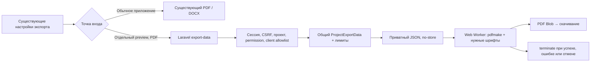

# Milestone 6.1 — прототип PDF в браузере

Рекомендация: **дорабатывать перед интеграцией**. Прототип формирует настоящий текстовый PDF на RU / EN / TR / ZH-CN, включая 500 задач со всеми полями и китайским пользовательским текстом. Основная работа перенесена в Web Worker; PHP готовит только разрешённый JSON. Safari и физические смартфоны пока не проверены, а первая загрузка CJK-шрифтов слишком велика для уверенной рекомендации выпуска.

Работа выполнена в `codex/milestone-6-1-browser-pdf`, от актуального Milestone 6.0 `cae60d4` и коммита его измерений `bc73443`. Существующий серверный PDF и DOCX остаются рабочим вариантом приложения. Прототип имеет отдельную точку входа; API выключен по умолчанию. Push, deployment, production ZIP и включение для реальных пользователей не выполнялись.

## Что переиспользовано

Аудит охватил `ProjectExportData`, оба exporter-класса, Blade `exports/specification`, `ProjectExportRequest`, существующие admin/client маршруты, middleware доступа, настройки полей и шрифты Milestone 6.0.

`ProjectExportData::build()` уже возвращает явный allowlist документа: заголовок, проект, разделы, нумерацию, выбранные блоки, готовые строки метаданных, суммы и локализованные подписи. Он используется новым endpoint без второй реализации расчётов. Валюта, minor units, округление, статусы, фильтры all/approved/done и клиентские ограничения остаются серверными. Пользовательский текст не переводится и не интерпретируется как HTML.



## Реализация и границы прототипа

- Новые POST `/api/admin/projects/{project}/export-data` и `/api/client/project/{project}/export-data` используют существующие request/middleware. Admin требует `export_project`; client использует существующую сессию доступа к проекту. Чужой проект, отозванный доступ и запрет экспорта проверены тестами.
- Даже при подделке `fields` клиент не получает заметки разработчика, цены, часы, внутренние ID, пути хранения и токены. В JSON передаётся только результат общего builder, без сериализации ORM-моделей.
- Ответ: `schemaVersion: 1`, безопасное имя файла, `document`; `private, no-store`, `Pragma: no-cache`, `nosniff`. Приватные документы не записываются в localStorage, sessionStorage, IndexedDB или Cache API. Браузер сохраняет только обычные настройки приложения и публичные ресурсы. Отдельный кеш `projectbrief-pdf-public-fonts-v1` содержит исключительно TTF, что дополнительно проверяет E2E.
- `BROWSER_PDF_PROTOTYPE_ENABLED=false` по умолчанию. Лимит — 5 запросов/минуту на сессию, 1000 выбранных задач, 2 МиБ суммарного выбранного task-текста до загрузки ORM, 8 МиБ итогового JSON. Существующий экспорт этих новых ограничений не получает. Количество/байты считаются после scope и клиентского allowlist. Это защитные границы прототипа, не гарантия экспорта любых данных в пределах лимита: длины имён разделов и вложений могут дополнительно увеличить документ.
- Диагностические заголовки времени builder и `memory_get_peak_usage(true)` выдаются только при `APP_ENV=testing` и `BROWSER_PDF_DIAGNOSTICS=true`.
- `preview/browser-pdf/main.js` открывает существующее Vue-приложение с опциональным renderer через `provide`. Обычная точка входа его не подключает. DOCX и серверный PDF не импортируют pdfmake.
- Версия pdfmake закреплена на **0.3.13**. Библиотека, Worker и шрифты загружаются при экспорте. Worker имеет watchdog 120 секунд и уничтожается после любой развязки; отмена останавливает HTTP-ожидание или Worker. Объектный URL скачивания освобождает существующая `saveProjectExport`.
- Используются текущие поля формы, независимый язык документа, заголовок и разрыв по разделам. Только preview добавляет уведомление о прототипе, этапы и кнопку отмены. После ошибки форма позволяет повторить экспорт.

## Вёрстка, Unicode и шрифты

A4, отступы около 20 мм, заголовки проекта/разделов/задач, блоки текста, списки имён вложений, готовые серверные метаданные, итоги и `страница / всего`. Браузерная пагинация отличается от Dompdf; совпадение числа страниц и байтов не является критерием. Табличные расчёты на клиент не перенесены: текущий серверный формат выводит метаданные строками, и прототип сохраняет этот способ.

Короткая последовательность «раздел / задача / подпись / первый абзац» удерживается вместе. В `unbreakable` попадают только группы до 600 Unicode-символов, без табуляций и с максимум восемью переводами строки; произвольные длинные пользовательские блоки остаются разбиваемыми. Для них применяется штатный `pageBreakBefore`, исключающий footer при поиске следующего текста. Наивная проверка каждого заголовка с повторной вёрсткой всего большого документа оказалась неприемлемо медленной и в финальном варианте не используется для коротких групп.

DejaVu Sans regular/bold загружаются для каждого экспорта; полные Noto Sans SC regular/bold — только при обнаружении CJK в фактическом документе. Это касается и RU/EN/TR с китайским пользовательским текстом. Noto SC не содержит всех турецких глифов, поэтому исходные строки разбиваются на последовательности DejaVu/Noto по codepoint; `ç ğ ı İ ö ş ü`, кириллица, Han и китайская пунктуация сохраняются. Диакритические combining marks остаются со своим предыдущим run. Прототип не обещает поддержку всех мировых письменностей за пределами четырёх языков ТЗ.

Полные файлы шрифтов: **22 644 176 байт (21,6 МиБ)** вместе; из них Noto — **21 181 416 байт (20,2 МиБ)**. Они не входят в основной JS. PDFKit/fontkit в составе pdfmake встраивают subset реально использованных глифов: итоговый PDF значительно меньше исходных TTF. Наличие FontFile2 и ToUnicode проверено в каждом образце; страниц-картинок нет. Subsetting уменьшает PDF, но не отменяет загрузку и разбор полного TTF в Worker. После завершения Worker освобождается; немедленное уменьшение RSS браузера не гарантируется его allocator/GC.

Публичные TTF отдаются локальным preview с `public, max-age=31536000, immutable`; production-прототип build создаёт файлы с hash в имени. Проверка обнаружила повторную передачу больших CJK-файлов даже при правильных HTTP headers, поэтому Worker дополнительно использует Cache API только для публичных TTF. При недоступности хранилища/квоты экспорт продолжает работать с обычной загрузкой. Кеши и приватные документы не смешиваются; передача и попадания фиксируются `fontResources` и `fontCacheHits`. Каждый новый Worker всё равно читает и разбирает шрифт, cache hit не означает нулевую память. При возможной будущей раздаче нужен тот же cache policy для публичных hashed assets и `no-store` для API. В dev при изменении TTF следует очистить этот публичный кеш или повысить его версию. Время localhost нельзя переносить на мобильную сеть.

Лицензии сохранены в исходниках и выводятся build-плагином в `font-licenses`: Noto Sans SC — SIL OFL 1.1, DejaVu — Bitstream Vera/DejaVu license, pdfmake — MIT. Не переименовывались и не распространялись изменённые TTF. Созданные PDF содержат встроенные subsets; полные лицензии должны оставаться в комплекте распространяемого прототипа.

API pdfmake сверены с первичными источниками: [клиентские шрифты](https://pdfmake.github.io/docs/0.3/fonts/custom-fonts-client-side/url/), [методы создания PDF](https://pdfmake.github.io/docs/0.3/getting-started/client-side/methods/), [страницы и разрывы](https://pdfmake.github.io/docs/0.3/document-definition-object/page/), а также установленными исходниками 0.3.13 для бинарного VFS и ограничений unbreakable.

## Методика измерений

Тот же ноутбук и PHP из [Milestone 6.0](../milestone-6-0/performance/README.md): Intel i7-8559U, 4/8 CPU, 16 GiB RAM, macOS 14.8.9, PHP 8.5.10, Laravel 13.34.0. Сервер — отдельная временная копия приложения/vendor/fonts, свежая SQLite, пустой `.env`, mail array, локальные адреса, `memory_limit=128M`, `max_execution_time=30`, OPcache выключен. Реальная БД, production и пользовательские проекты не использовались. Создаются 1220 задач для основной матрицы и две дополнительные для длинного текста; временный стенд удаляется.

Основная матрица: **48 комбинаций**, 10/100/500 × RU/EN/TR/ZH-CN × default/full × mixed/cjk. Три раздела; описание 300 символов, expected result 100, developer notes 80, одно имя вложения, USD 975.50 и 8.25 часа на задачу; половина согласованы. `mixed` содержит EN/TR/RU без Han; `cjk` заменяет часть того же по длине описания китайским фрагментом. Default: description/expectedResult/priority/status. Full: все существующие поля. Синтетический текст повторяется, реальные уникальные тексты могут дать более крупный PDF.

В финальной таблице Browser — **один прогон на комбинацию**, Dompdf baseline — медиана трёх свежих CLI-процессов. Это локальный сравнительный эксперимент, не p95 и не SLA Jino. Browser API включает HTTP/auth/JSON; прежний Dompdf CLI включает bootstrap/build/render, но не HTTP. Worker/library/fonts имеют собственные интервалы, общее время заканчивается получением Blob; файловая запись E2E вне этого времени. Первый API включает получение CSRF cookie, последующие — готовую сессию. Библиотека измеряется как import/инициализация, не только передача байтов. Dev-модули Vite влияют на время; production build отдельно проверен, но не представлен как измеренный production-host benchmark.

Память PHP — `memory_get_peak_usage(true)` всего запроса, не RSS. Память браузера — сумма RSS **всего принадлежащего стенду дерева процессов** (browser/renderer/GPU/utility), выборка раз в 100 мс. Общие страницы могут считаться повторно, краткие пики могут быть пропущены. Это наблюдение ОС, **не точный peak JS heap или память вкладки**. Точный изолированный peak heap Worker достоверно не измерен и не подменён оценкой. CPU — разность накопленного user+system времени этих PID, с отдельным `observedWindowMs`; завершившиеся между выборками процессы могут дать недоучёт. Серверные тесты и другие benchmark-процессы не запускались одновременно с финальной матрицей.

## Результаты

Все 48 комбинаций завершились. [Полная сравнительная таблица Dompdf vs Browser](comparison.md), [48 строк CSV](performance.csv), [исходные интервалы/CPU/RSS/font transfers](chromium-matrix.json). Отдельный [edge case](edge-case.json) проверяет длинный китайский абзац, URL без пробелов и разрывы по разделам.

Главный сценарий **500/full/Han/ZH-CN**:

| Метрика | Результат |
| --- | ---: |
| API / JSON | 276.6 мс / 630,113 байт |
| Общий builder + сериализация (Server-Timing) | 129,1 мс |
| Пик PHP всего запроса | 32 МиБ |
| Import/инициализация pdfmake в Worker | 119.1 мс |
| Чтение четырёх кешированных TTF | 44.1 мс |
| Генерация PDF в Worker | 1651.8 мс |
| Всего до Blob | 2.104 с |
| Готовый PDF | 1,164,047 байт / 201 страница |
| Browser RSS: до / наблюдённый максимум всего дерева | 614.5 / 671.5 МиБ |
| Browser CPU / окно наблюдения | 2.61 CPU-с / 2.432 с |
| Максимальный интервал heartbeat (период 20 мс) | 22.5 мс, 105 срабатываний |

Во всей матрице — 0.36–2.10 с до Blob и 26–32 МиБ PHP. Первый CJK-запуск передал два Noto (20,2 МиБ), этап шрифтов занял 331,9 мс на localhost; повторные CJK-запуски имели четыре Cache API hits и нулевую новую сетевую передачу TTF. В mixed/RU/EN/TR CJK не загружался. В главном PDF четыре декодированных embedded font streams занимают только **47 824 байта** ([подробности](font-subsets.json)); прочая часть PDF — текстовые операторы, страницы и служебные структуры. Повторяющиеся синтетические данные и ограниченный набор Han не характеризуют все реальные документы.

Прежний Dompdf при 500/full исчерпывает **128M на всех четырёх языках**. Диагностический, отдельно разрешённый стенду прогон 6.0 с 512M для cjk/500/full/ZH-CN занимал **17,35 с / 248 МиБ PHP / 716 413 байт PDF**. Глобальные лимиты приложения не повышались. Браузерная версия уменьшает PHP-нагрузку, но переносит CPU и сотни МиБ RSS на пользовательское устройство; это не бесплатное снижение суммарной памяти системы.

Обычная сборка: main entry **428,29 kB / gzip 146,69 kB** по Vite против 426,13 / 145,89 kB baseline; разница около 2,16 / 0,80 kB от опциональной интеграции, отмены и сообщений. В обычном `dist` нет pdfmake, Worker или TTF. Отдельный prototype build: main 429,74 kB, ленивый pdfmake 787,01 kB и Worker 5,10 kB; четыре внешних TTF 22,64 MB. [bundle-sizes.json](bundle-sizes.json) даёт точные байты и отдельную оценку gzip через Python (алгоритм сжатия отличается от отчётного Vite).

## Проверки и совместимость

| Проверка | Результат |
| --- | --- |
| Frontend unit | **251 / 251**, без пропусков |
| Laravel | **681 / 681**, 8 306 assertions |
| Новые API feature tests | 5 тестов / 58 assertions (входят в полный suite) |
| Обычный build + отдельный prototype build | успешно |
| Pint и форматирование изменённых JS/Vue | успешно |
| Основная матрица | **48 / 48** |
| Chromium 151.0.7922.34, desktop/mobile × 4 языка | **8 / 8** |
| Firefox 153.0, desktop/mobile × 4 языка | **8 / 8** |
| Клиентский UI/JSON и скачивание, Chromium | **8 / 8**, только 6 разрешённых полей |
| Главный сценарий desktop/mobile | Chromium ~2,10 / 2,05 с; Firefox ~2,52 / 2,47 с |
| Отмена Worker/UI, ошибка шрифта и повтор | успешно |
| Safari/WebKit / физический смартфон | **не подтверждено** |

Сырые результаты: [compatibility.json](compatibility.json), [checks.json](checks.json), [автоматический разбор PDF](pdf-verification.json). Проверены **42 PDF / 2 862 экземпляра задач**. Для прямого сравнения создано четыре [Dompdf reference PDF](dompdf-cjk-10-full-zh-CN.pdf) тем же неизменённым endpoint на отдельном стенде. Все browser/reference PDF проверяются по соответствующему серверному JSON: извлекаемый исходный текст, число/порядок/нумерация задач, блоки, метаданные, итоги, A4, embedded fonts и ToUnicode. Для browser дополнительно проверяется отсутствие заголовка задачи без начала первого абзаца; для edge — отдельные страницы разделов. Печатные рендеры browser и Dompdf сопоставлены визуально, включая длинный китайский блок. Совпадение пикселей не ожидается.

Chromium и Firefox проверены через реальные страницы admin/client и скачивание файла, а не только вызов функции. Ошибка загрузки шрифта → сообщение → повторный успешный экспорт; отмена во время генерации → освобождение Worker → доступная форма. Проверены отсутствие горизонтального overflow на ширинах 1440/390 и отсутствие приватного содержимого в local/session storage. Четыре языка интерфейса и документа переключаются штатными элементами формы. Mobile — эмуляция viewport/touch на ноутбуке, **не производительность физического смартфона**.

WebKit build 2251 не смог создать даже пустую страницу в текущем macOS-окружении за 20 секунд, до открытия приложения. Это ограничение стенда, не доказанная ошибка pdfmake. Safari/macOS и iOS имеют статус **не проверено**; отдельный повтор с пустой страницей воспроизвёл проблему. Реальная печать на принтере и clipboard конкретного PDF reader не проверены: подтверждены A4, встроенные шрифты, ToUnicode и извлечение исходного текста. Окончательное принятие требует таких проверок на целевых устройствах.

Образцы full/Han: [RU](browser-cjk-10-full-ru.pdf), [EN](browser-cjk-10-full-en.pdf), [TR](browser-cjk-10-full-tr.pdf), [ZH-CN](browser-cjk-10-full-zh-CN.pdf), [500 задач ZH-CN](browser-cjk-500-full-zh-CN.pdf), [длинный текст](browser-cjk-edge-2-full-zh-CN.pdf). JSON рядом с PDF — только синтетические данные. Скриншоты: [desktop ZH-CN](chromium-1440-zh-CN-admin.png), [mobile ZH-CN](chromium-390-zh-CN-admin.png), [client mobile](chromium-390-zh-CN-client.png), [процесс](chromium-390-zh-CN-progress.png); все RU/EN/TR и Firefox также в этом каталоге. Рендеры: [первая](pdf-500-zh-CN-first.png), [середина — стр. 125](pdf-500-zh-CN-middle.png), [последняя страница](pdf-500-zh-CN-last.png), [серверный PDF](dompdf-zh-CN-page-1.png), [длинный абзац — стр. 2](pdf-edge-zh-CN-middle.png).

## Решение и дальнейшие шаги

**Дорабатывать.** Главный сценарий работает, настоящие Unicode-глифы и права сохранены, UI не блокируется генерацией. Для замены Dompdf пока не подтверждены Safari/iOS, бюджет физического смартфона и приемлемая первая загрузка 21,6 МиБ шрифтов. Снижение PHP-памяти само по себе не закрывает эти требования.

1. Проверить Safari/macOS и физические iOS/Android, включая 500/full/Han, отмену, низкую память, печать/копирование и медленную сеть. Не объявлять viewport 390 тестом реального телефона.
2. Отдельно исследовать доставку CJK-шрифтов: готовые статические subsets/common glyph sets с полным fallback, либо совместимый более компактный формат. Проверять glyph coverage оригинального текста перед выбором; не использовать только системный шрифт, не растрировать страницы и не обрезать редкие Han ради экономии. Runtime subsetting внутри PDF уже работает; уменьшение скачиваемых TTF — отдельная задача.
3. Измерить JSON endpoint на целевом MySQL/Jino и согласовать лимиты размеров/параллельных запросов. SQL byte-preflight проверен здесь на SQLite; MySQL-ветка `OCTET_LENGTH` требует целевого прогона.
4. После отдельного согласования возможен гибрид: проверенные браузеры — opt-in browser PDF; существующий PDF для небольших документов, существующий DOCX для больших. Не делать автоматический server fallback для 500/full: известный OOM останется. Ничего из этого автоматически не включено.

Альтернативы: [HTML + CSS Print](https://developer.mozilla.org/en-US/docs/Web/CSS/CSS_media_queries/Printing) сохраняет HTML/текст и использует движок браузера, но требует print dialog и отдельной проверки CSS pagination/колонтитулов; полностью контролируемое фоновое скачивание не даёт. [jsPDF](https://github.com/parallax/jsPDF) поддерживает Unicode через собственные TTF, но для текущего многостраничного flowing layout потребует больше ручной пагинации. pdfmake подходит для изолированного Worker-прототипа благодаря text flow, спискам, стилям и footer-функциям. HTML-to-image для страниц не рассматривался как рабочая замена.

## Воспроизведение и изменённые области

```sh
npm ci
npm test
npm run build
npm run build:browser-pdf
cd api
PHP_INI_SCAN_DIR=:$PWD/dev-php php artisan test --compact
vendor/bin/pint --dirty --format agent
```

Для E2E нужен Playwright с установленными Chromium/Firefox/WebKit (test-only инструмент, не сервис backend). `PLAYWRIGHT_MODULE` может указывать на абсолютный путь `playwright/index.mjs`, если пакет предоставлен внешним runtime:

```sh
PLAYWRIGHT_MODULE=/absolute/path/to/playwright/index.mjs npm run test:browser-pdf
PLAYWRIGHT_MODULE=/absolute/path/to/playwright/index.mjs M61_COMPAT=1 npm run test:browser-pdf
PLAYWRIGHT_MODULE=/absolute/path/to/playwright/index.mjs M61_REFERENCE=1 npm run test:browser-pdf
python3 docs/milestone-6-1/verify-pdfs.py
python3 docs/milestone-6-1/summarize.py
```

Harness сам создаёт и удаляет отдельный backend/SQLite. Не направлять его на production. Результаты перезаписываются в этом каталоге; перед новым измерением сохранить предыдущие. Для ручного preview использовать только тестовый backend с `BROWSER_PDF_PROTOTYPE_ENABLED=true`, затем `API_PROXY_TARGET=http://127.0.0.1:<test-port> npm run dev:browser-pdf`. Build — отдельный `artifacts/milestone-6-1/prototype-build`, игнорируется Git и не включается в релиз.

Изменённые области: backend controller/config/routes/rate limiter и опциональные лимиты общего builder; четыре словаря сообщений ошибок; опциональный renderer в общей форме и AbortSignal API; отдельный preview/Worker/fonts/layout; package/lock; feature/unit/browser tests; синтетическая fixture; этот отчёт, метрики, PDF и скриншоты. Новых миграций, ролей, бизнес-вычислений и изменений DOCX нет. [SHA-256 исходников старого экспорта](legacy-export-sha256.json) сверены с `bc73443`; [размеры bundle](bundle-sizes.json) и `SHA256SUMS` фиксируют артефакты. Полный [список изменённых файлов](changed-files.txt) включает исходники и синтетические образцы.
