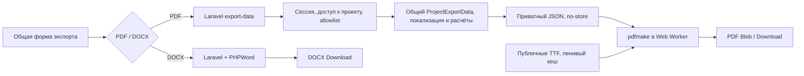

# Milestone 6.2 — браузерный PDF и компактный экспорт

Реализован переход **PDF: Laravel JSON API → Web Worker → pdfmake → Browser Download**. **DOCX: Laravel → PHPWord → Download**. Серверный PDF, Dompdf и fallback удалены. Новые проекты в admin и REST создаются с пустой структурой; разделы добавляются вручную. Production и push не выполнялись.

Ветка `codex/milestone-6-2-browser-pdf-integration`, основа — прототип 6.1 `cd008cd`. Результаты его масштабных измерений приняты согласно ТЗ; новое исследование производительности не проводилось. Исторические отчёты 6.0/6.1 сохранены без изменений. Финальный ZIP/source commit/SHA-256 публикуются после сборки в RELEASE-ARTIFACT.json.

## Изменения

- Renderer перенесён в `src/services/pdf`: index, Worker, definition, fonts, font-cache. Основная форма лениво импортирует адаптер; JSON приходит до запуска Worker. Библиотека и четыре TTF не входят в основной JS. Noto загружается только при CJK, включая китайский пользовательский текст в RU/EN/TR.
- Удалён опциональный provide/inject adapter, отдельный preview и его команды/fixture/benchmark. JSON endpoint работает штатно, флаги прототипа и диагностические заголовки удалены. Сохранены no-store, лимиты объёма и частоты, существующие middleware/CSRF/permission/client allowlist.
- `/export-data` отдаёт только PDF JSON; `/export` создаёт только DOCX. Попытка заказать PDF у `/export` получает 422. При ошибке/отмене браузерного экспорта серверный PDF не запускается.
- Две колонки настроек при viewport от 1024 px; одна на планшете/mobile. Слева заголовок, scope и разрывы; справа выбранные поля и язык. Проект уже определён маршрутом, новые селекторы проектов/разделов не добавлены. Общая область действий PDF/DOCX, сообщения этапов, отмена, ошибка и повтор. Значения по умолчанию и зависимости прежние. Светлая/тёмная темы используют существующие токены; touch targets сохранены.
- Удалены стартовые разделы из общего `ProjectCreation`, используемого admin и REST. Непустое `sections` в административном создании запрещено. Пустой проект предлагает первый раздел только с `manage_structure`; клиент видит информационное состояние. После ручного создания раздела обычные идеи/задачи работают по прежней логике.
- Миграций, изменения валюты/расчётов/ролей/пользовательских настроек нет. `ProjectExportData` и `DocxProjectExporter` побайтово совпадают с 6.1; `ExportFonts` лишился только PDF-специфичного метода. Старые проекты/разделы не переписываются. Test factories и явно запрашиваемый demo seed продолжают описывать готовые демонстрационные данные; обычное создание проекта их не использует.



## Удалённые компоненты

`PdfProjectExporter.php`, `resources/views/exports/specification.blade.php`, метод `ExportFonts::pdfFamilies()`, 125 Dompdf-ресурсов (31 пары shard fonts/метрик плюс каталог), отдельная точка входа `preview/browser-pdf`, exportRenderer injection, флаги enabled/diagnostics, старый benchmark/fixture и PDF renderer assertions.

Composer удалил **dompdf/dompdf, dompdf/php-font-lib, dompdf/php-svg-lib, masterminds/html5, sabberworm/php-css-parser**. Других обновлений Composer-пакетов нет. В lock metadata PHPWord есть upstream optional require-dev/suggest о PDF-адаптерах; это не установленные production-зависимости. Production validator проверяет реальные installed packages и отсутствие файлов старого renderer.

DejaVu Sans regular/bold скопированы без изменения из прежней поставки в исходные ресурсы приложения. Полные Noto regular/bold и лицензии сохранены для браузера и редактируемого DOCX. Полный [список удалений](removed-components.json), [происхождение/лицензии шрифтов](../../api/resources/fonts/SOURCE.md).

## Проверки

| Проверка | Результат |
| --- | --- |
| Frontend unit | **251 / 251**, без пропусков |
| Laravel | **682 / 682**, **8 057 assertions** |
| Production Vue build | успешно |
| Pint / форматирование / diff check | успешно |
| Chromium 151.0.7922.34: RU/EN/TR/ZH-CN, desktop/mobile | **8 / 8** |
| Firefox 153.0: RU/EN/TR/ZH-CN, desktop/mobile | **8 / 8** |
| Планшет 768 px, TR/dark | одна колонка, без overflow |
| Client UI/подделка полей | 8 UI случаев, только 6 разрешённых полей, без часов/цен/заметок |
| Отмена, ошибка шрифта, повтор | успешно, без server fallback |
| Новый проект через UI и REST, пустой экспорт/обсуждения | успешно |
| Первый раздел вручную / сохранность старой структуры | успешно |
| PDF | **30 файлов / 300 экземпляров задач**, порядок, Unicode, суммы, A4, embedded fonts/ToUnicode, без страниц-картинок |
| DOCX | полный Laravel regression suite + admin EN/client ZH-CN browser downloads |
| Safari / физические смартфоны | **не проверялись**, совместимость не заявляется |

Данные: [checks.json](checks.json), [browser-results.json](browser-results.json), [pdf-results.json](pdf-results.json). Все образцы синтетические, без production-данных. Стенд — отдельная копия backend, пустой env, свежая SQLite, mail array, PHP 128M / 30 секунд. Browser smoke запускается против **production build** через localhost preview/proxy, а не старой точки входа. После теста копия/БД/серверы удаляются. Повторное создание проекта проверяет секции исходного проекта и сохранение ранее существовавшей задачи; REST tests проверяют пустоту, идемпотентность и external identity.

PDF проверены извлечением всех исходных текстов, порядка задач и готовых серверных итогов, затем визуально просмотрены рендеры ZH-CN и TR. Физическая печать и Safari/iOS не входят в подтверждённую матрицу. Никакого сравнения производительности на новых 500-task наборах не выполнялось.

## Сборка и размер

Основной production entry: **429,91 kB / gzip 147,11 kB** по Vite. Для сравнения обычная 6.1-сборка имела 428,29 / 146,69 kB. pdfmake **787,01 kB** и Worker около **5,1 kB** — отдельные ленивые чанки, а не часть main entry. Четыре TTF — **22 644 176 байт**, в том числе Noto **21 181 416 байт**. Первый CJK export требует их загрузки; Cache API хранит только публичные шрифты. Извлечение subset в PDF не сокращает исходные скачиваемые TTF. [Точные размеры всех JS/TTF](bundle-sizes.json); gzip там измерен Python и может отличаться от Vite.

ZIP собирается существующим `bin/build-release`: чистый commit, npm ci/tests/build, Laravel tests, production Composer install без dev, runtime test отдельной копии, проверка отсутствия секретов/SQLite/sourcemaps/старого PDF, checksums. Включены текущие public JS/Worker/TTF/licenses, private PHPWord/полные DOCX-шрифты и руководства. Архив также содержит исторические guides; его размер не равен размеру загружаемого браузером JS. Производственный vendor заменяется целиком, чтобы удалённые зависимости не остались от предыдущей версии.

## Образцы и скриншоты

PDF: [RU](sample-ru.pdf), [EN](sample-en.pdf), [TR](sample-tr.pdf), [ZH-CN](sample-zh-CN.pdf). Рендеры: [ZH-CN](pdf-zh-CN-first.png), [TR — стр. 2](pdf-tr-page-2.png). DOCX: [admin EN](sample-en.docx), [client ZH-CN](sample-client-zh-CN.docx).

Экспорт: [desktop ZH-CN/light](chromium-1440-zh-CN-export.png), [desktop TR/dark](chromium-1440-tr-export.png), [mobile TR/dark](chromium-390-tr-export.png), [mobile ZH-CN/light](chromium-390-zh-CN-export.png), [client mobile](chromium-390-zh-CN-client-export.png), [tablet 768](tablet-768-tr-dark-export.png). Остальные RU/EN/Firefox — рядом.

Пустой проект: [admin desktop](empty-admin-desktop.png), [admin mobile/dark](empty-admin-mobile-dark.png), [client mobile](empty-client-mobile.png), [сообщение пустого экспорта](empty-export-message.png).

## Обновление, откат и воспроизведение

[Экспорт](../EXPORT.md), [API](../API-EXPORT.md), [обновление/откат](PRODUCTION.md), [release notes](RELEASE.md), [DEPLOY-JINO](../../DEPLOY-JINO.md). Изменения не развёрнуты автоматически.

```sh
npm ci
npm test
VITE_DATA_SOURCE=api VITE_API_BASE_URL= npm run build
cd api
PHP_INI_SCAN_DIR=:$PWD/dev-php php artisan test --compact
vendor/bin/pint --dirty --format agent
```

Из корня репозитория с установленными Playwright Chromium/Firefox:

```sh
PLAYWRIGHT_MODULE=/absolute/path/to/playwright/index.mjs npm run test:export
python3 docs/milestone-6-2/verify-pdfs.py
./bin/build-release
```

Playwright и pypdf/Poppler — test-only инструменты; Node/Python/браузеры не добавлены на backend. `test:export` создаёт только временный testing/SQLite стенд; production endpoint ему не задаётся. Для ZIP нужен чистый Git tree, Composer, PHP extensions и Node/npm, как и прежде. На локальном стенде для доверенного npm TLS используется системный CA через NODE_EXTRA_CA_CERTS, без отключения TLS. Финальные сведения архива находятся в release.json внутри ZIP и RELEASE-ARTIFACT.json рядом с этим отчётом после сборки.
