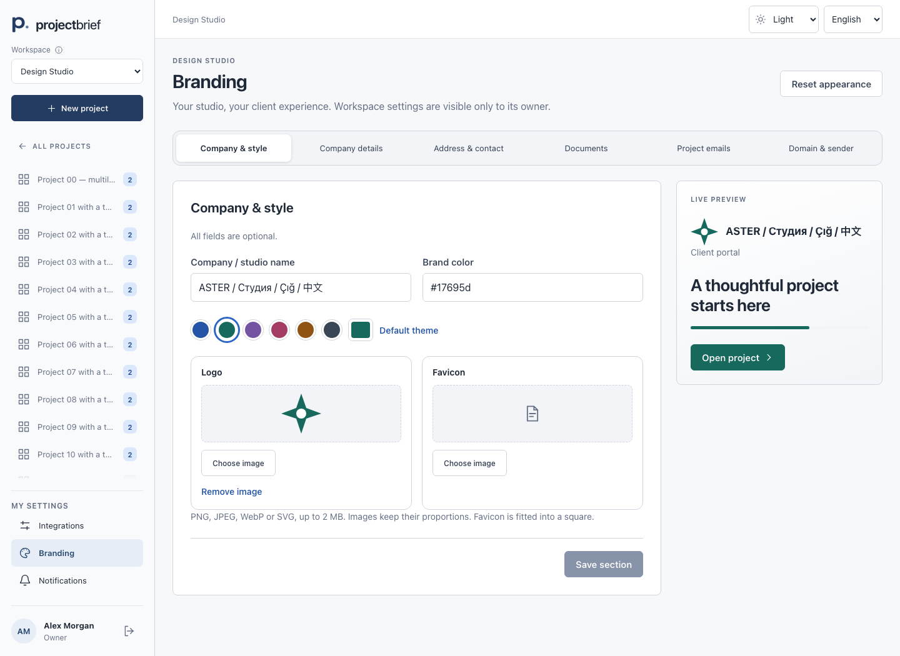
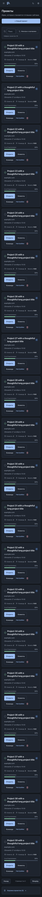
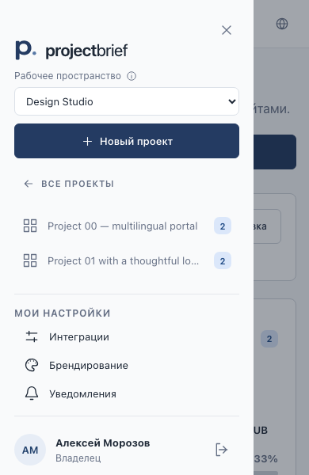

# Milestone 7.5 — брендирование workspace и навигация

Реализованы три части задания: настройки бренда владельца, сайдбар с отдельной прокручиваемой серединой и серверный список проектов по 20 записей. Зависимости не добавлялись. Сохранены роли, workspace scope, security step-up, существующие exports/email transport, корзина, темы и RU/EN/TR/ZH.

По первому поручению пользователя `codex/milestone-7-4-ui-feedback` fast-forward опубликована в `projects-manager/main`: `29d5583dc29b54edb83501909fcad3164c347e3b`. Затем создана локальная `codex/milestone-7-5`. Публикация 7.5 и deployment не выполнялись.

## Архитектура и решения

- `workspaces.branding` — nullable JSON с понятными секциями. Доступ: активный owner текущего workspace; UUID workspace в URL защищает от старого in-flight запроса после переключения. PATCH объединяет только указанную секцию под блокировкой. Model скрывает branding при обычной сериализации. Публичный клиентский ProjectResource получает только имя/цвет/визуальные URL. Реквизиты/контакты не включаются в публичный API и диагностические журналы.
- `WorkspaceBranding` — единые defaults и allowlist-проекции owner/portal/email/document. Без bank-флага реквизитов нет ни в PDF, ни в DOCX. Без email.enabled остаётся платформенный шаблон. Дополнительный цвет не вводился: один акцент и вычисленная контрастность достаточны.
- `BrandImage` — строгий DOM allowlist SVG, запрет entities/DOCTYPE, событий, внешних ресурсов, CSS, embedded images/scripts. Сервер возвращает очищенный SVG; браузер делает PNG на canvas, сервер повторно очищает SVG и нормализует PNG через GD. SVG никогда не вставляется в DOM. Растры также декодируются/перекодируются, метаданные удаляются. Logo вписывается до1024, favicon центрируется на прозрачном квадрате256; полноценная медиабиблиотека и ручной crop не добавлялись.
- Хранилище и rollback файлов используют существующий `AttachmentStorage::atomic` и durable `project_file_deletions`. В публичных URL нет private storage path. Нормализованные визуальные картинки намеренно доступны без сессии по непрогнозируемому URL для email. Это не публичный API настроек.
- `workspaceBranding` store сохраняет секциями; snapshot/revision не позволяет позднему ответу потерять новые правки или попасть в другой workspace. Сохранение/ошибка одной секции сохраняет другие черновики. Уход, logout и смена workspace учитывают несохранённое. Сброс подтверждается, возвращает оформление/флаги по умолчанию и сохраняет бизнес/контактные данные.
- Цветовые токены ограничены клиентским `apiProject` контекстом. Ссылка/фокус/прогресс адаптируются к светлой и тёмной поверхности; кнопка выбирает белый/чёрный текст с контрастом не ниже4.5. Семантические ошибки/успех не изменяются. Favicon и логотип платформы восстанавливаются вне портала.
- `ProjectExportData` передаёт одну проекцию двум существующим генераторам. Шапка logo + имя/контакты, затем прежний документ; footer контакты/дата/ссылка платформы/страницы. Реквизиты один раз после итогов. Короткий блок держится целиком, длинные заметки можно переносить. Сохранены CJK fonts, Unicode, цены/часы и варианты документа.
- Общие Blade brand-header/footer используются проектными письмами. NotificationPayload.project_uuid разрешает workspace на сервере перед отправкой; client invitation передаёт его явно. Системное восстановление/безопасность не получают бренд. Пользовательские строки экранированы, CSS inline, ссылки абсолютные, From/transport не менялись.
- `SidebarScroll` один для desktop и drawer: flex/min-height0, overflow только середины, ResizeObserver/MutationObserver и динамическая CSS mask без перекрывающего overlay. Список бокового меню подгружается серверными страницами. Верх/нижние настройки/профиль закреплены. Ссылка аккаунта сохраняется в профиле.
- `/api/admin/projects` использует ProjectAccess и Laravel paginate20. Поиск title; activity active/inactive; owner-only client name/email; updated/created/name + стабильный id tie-break. Сервер зажимает пустую страницу к последней. `projectListing` отделён от sidebar state, query allowlist и debounce300ms, stale response guard, URL и обратная навигация. Корзина остаётся SoftDeletes и существующим lifecycle.

## Только UI — backend не подключён

1. Желаемый custom domain портала: disabled пример `projects.agency.com`, описание будущего DNS и «Скоро».
2. Будущий собственный email sender: disabled пример, описание проверки домена/SPF/DKIM/DMARC.

Эти значения не сохраняются, DNS verification/SSL/custom routing/provider API отсутствуют, отправка с пользовательского адреса и фиктивный successful state не создаются. Остальные секции имеют рабочий backend.

## Проверки и материалы

См. [TESTS.md](TESTS.md), [список файлов](CHANGED-FILES.md), [production update/rollback](PRODUCTION.md), [скриншоты](screenshots/) и [превью документов](export-previews/). Production ZIP создаётся только каноническим `./bin/build-release`, содержит production vendor и собранный frontend; исходники frontend/tests/docs/screenshots/QA документы/runtime данные в него не попадают. Отчёт SHA-256/bytes: RELEASE-ARTIFACT.json после сборки.

Исходные тестовые PDF/DOCX/JSON и промежуточный render остаются в игнорируемом `artifacts/milestone-7-5/`; это синтетические данные. Скриншоты Vue используют управляемый API fixture; packaged HTTP проверяет реальный Laravel из чистого ZIP. Реальные Jino/PHP8.4/MariaDB, SMTP delivery, Safari и физические touch-устройства не проверялись.

Примеры:

