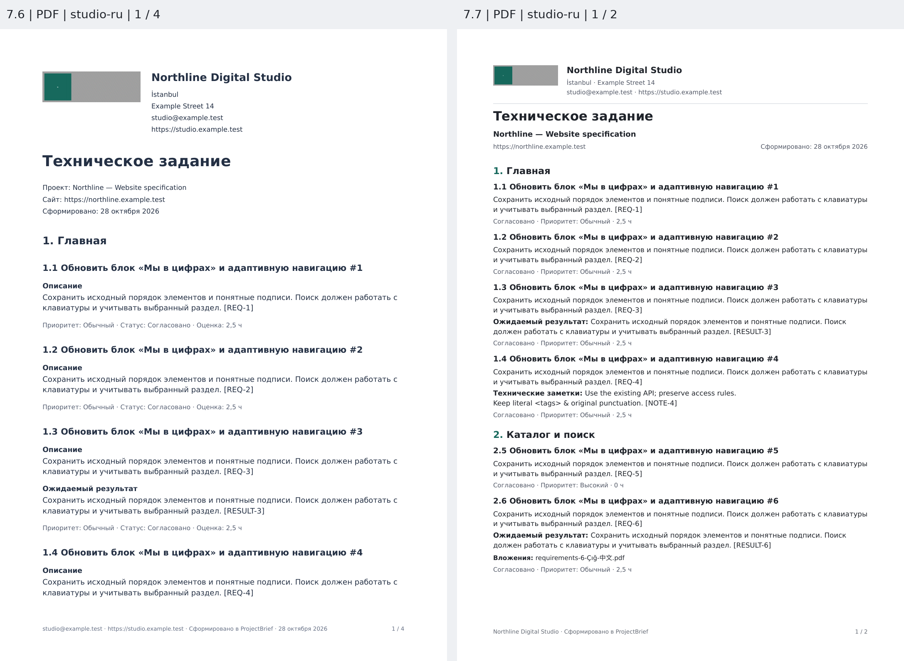
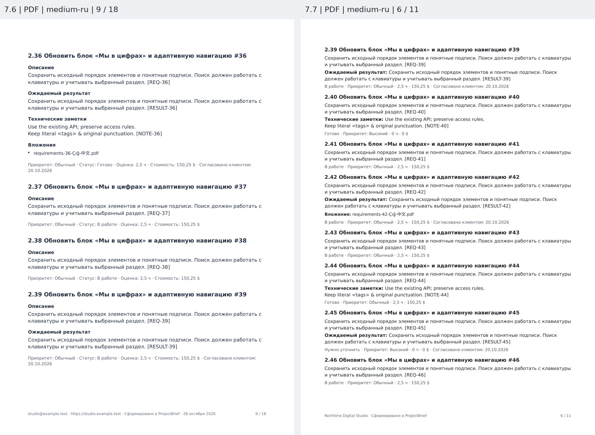
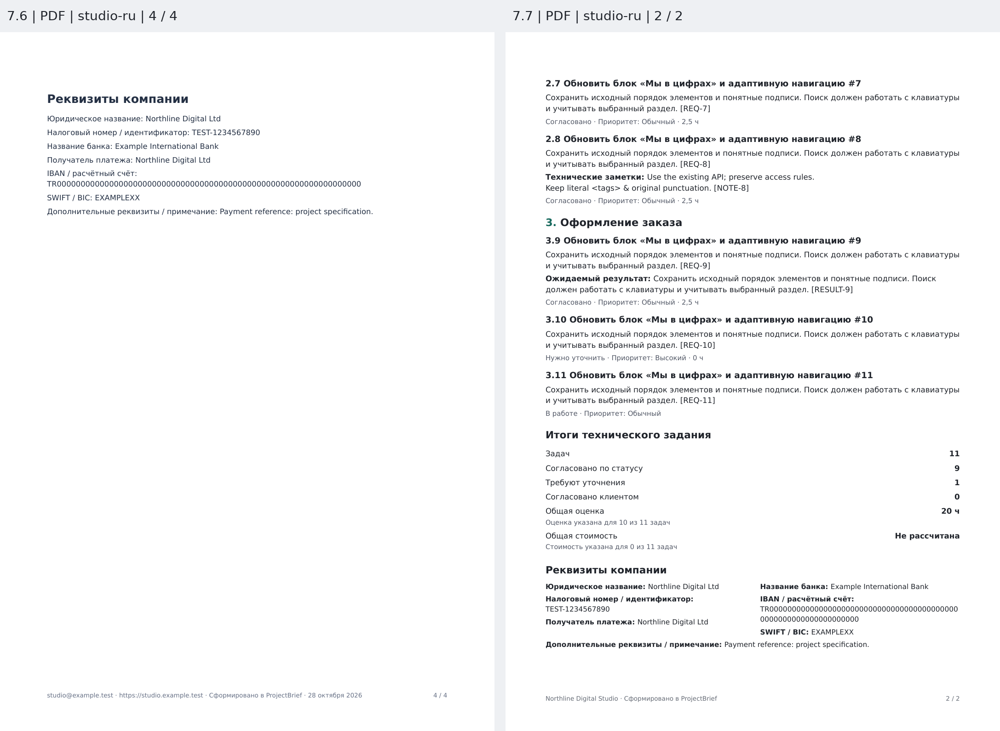
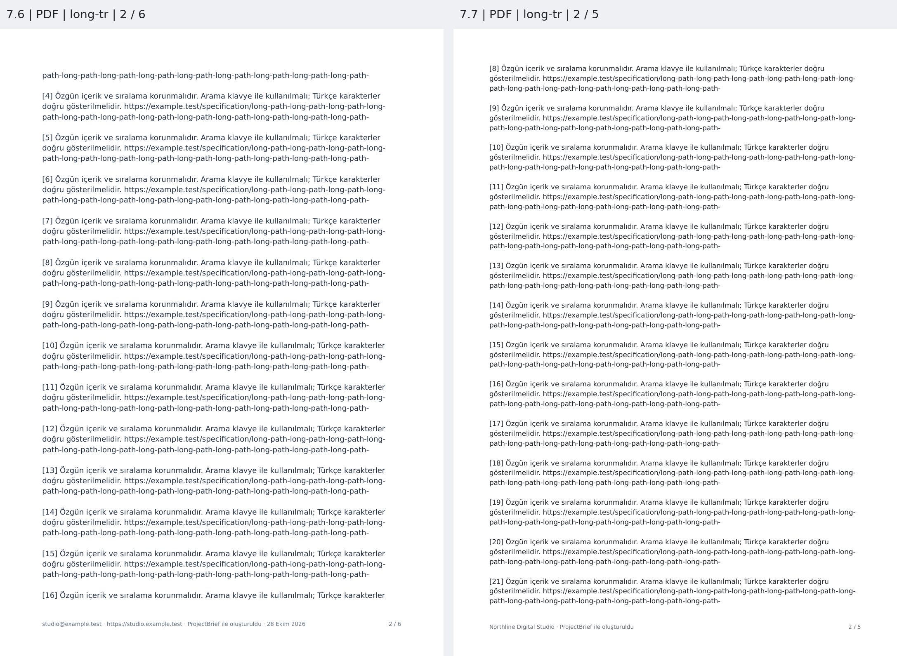
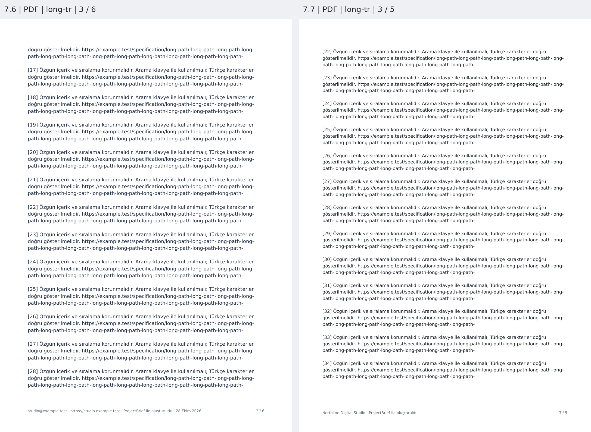
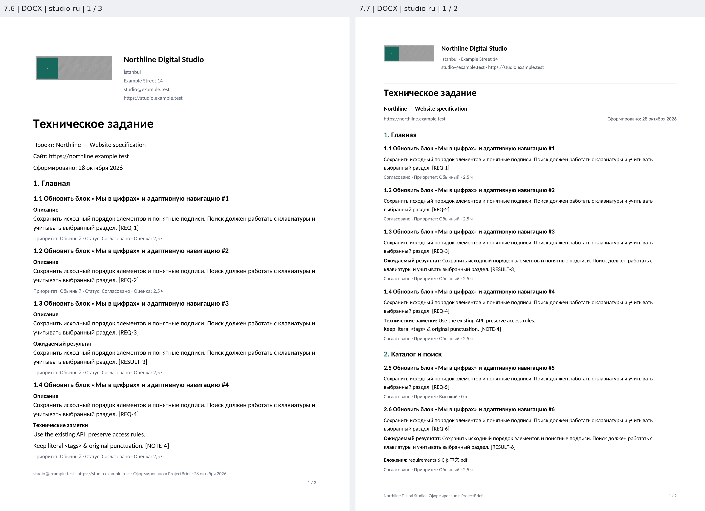
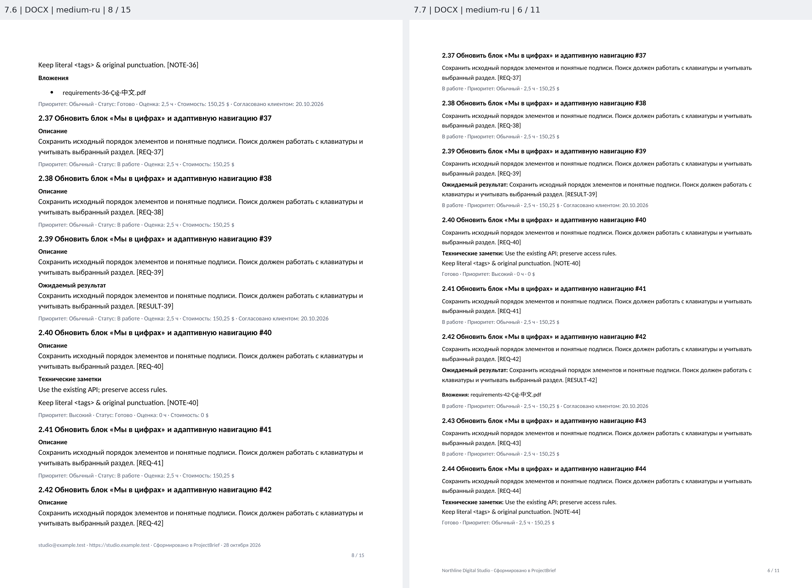
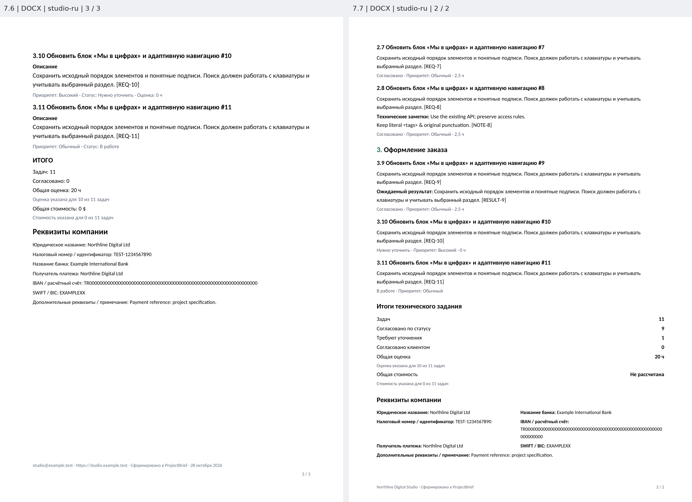
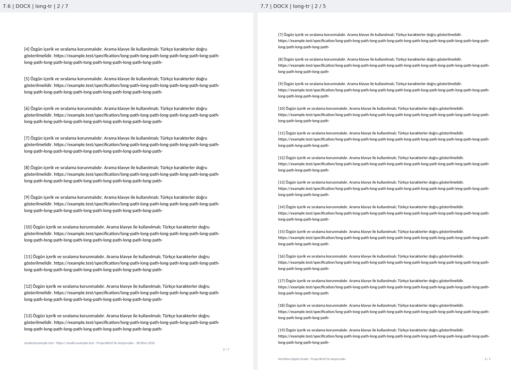
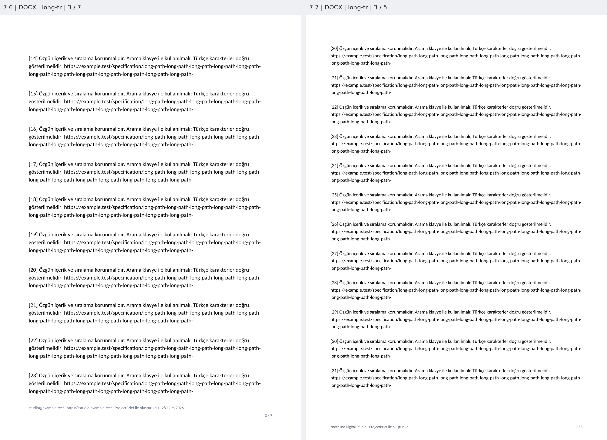

# Сравнение страниц 7.6 → 7.7

Слева прежний документ, справа новый, одинаковые синтетические данные. PDF отрендерен Poppler; DOCX — встроенным тестовым LibreOffice, затем Poppler. Масштаб внутри каждой пары одинаков. Это настоящие страницы, а не HTML-макеты.

## PDF — studio-ru, страницы 1 → 1

## PDF — medium-ru, страницы 9 → 6

## PDF — studio-ru, страницы 4 → 2

## PDF — long-tr, страницы 2 → 2

## PDF — long-tr, страницы 3 → 3

## DOCX — studio-ru, страницы 1 → 1

## DOCX — medium-ru, страницы 8 → 6

## DOCX — studio-ru, страницы 3 → 2

## DOCX — long-tr, страницы 2 → 2

## DOCX — long-tr, страницы 3 → 3

